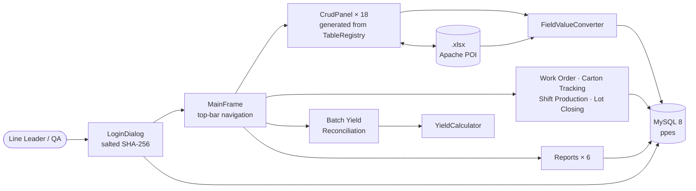
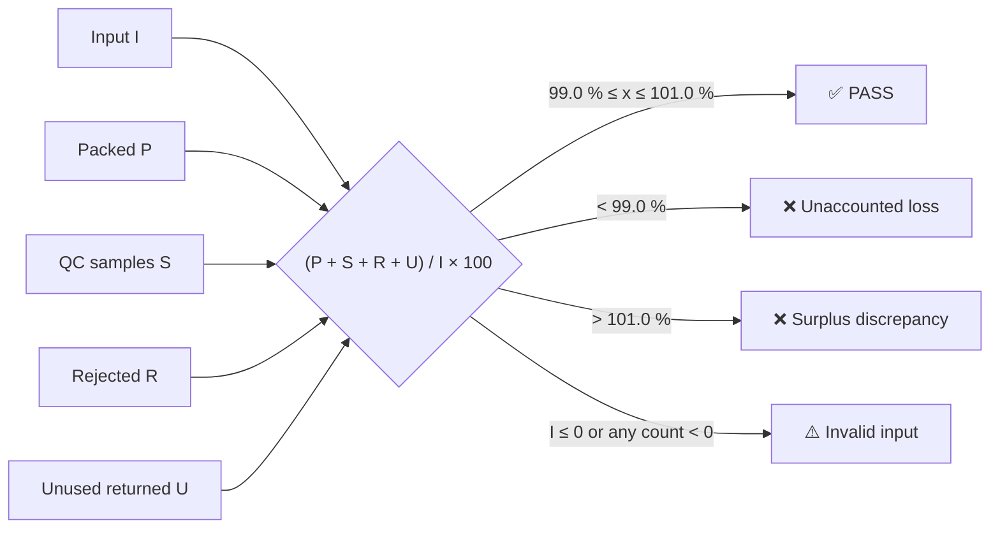

<div align="center">

# 💊 PPES — Pharmaceutical Packaging Management System

### A Java Swing desktop app for running a blister-packaging line: masters, lots, in-process checks, shift logs, carton tracking, lot closing and cGMP yield reconciliation, all on MySQL

[](https://git.io/typing-svg)

<!-- ============ STATUS BAR ============ -->
[](https://github.com/rbchy/PPES-Pharmaceutical-Packaging-Management/actions/workflows/ci.yml)


</div>

---

## 📌 At a Glance

<table>
<tr>
<td width="50%" valign="top">

**🙋 What this is**

A desktop app for the paperwork of a pharmaceutical blister-packaging line. It is modelled on real GMP shop-floor practice.

- **18 data tables:** masters, orders, lots, receiving, checklists, IPC, pallets, shippers, reconciliation, waste, placards. Every screen is generated from a single metadata registry.
- **5 production modules:** Work Order packaging maths, Carton Tracking, Shift Production log, Lot Closing, and the Batch Yield Reconciliation calculator.
- **6 reports**, plus Excel export and import on every table.
- **Bilingual help** (বাংলা / English), including a lot-starting SOP reference.

Every push builds the runnable jar and loads the full schema and sample data into **MySQL 8**. It then runs the unit and database tests and starts the app under a virtual display, all in GitHub Actions.

</td>
<td width="50%" valign="top">

**📍 Quick facts**

| | |
|---|---|
| 🖥️ **App** | Java Swing + FlatLaf dark, single shaded jar |
| 🗂️ **Data** | 18 registry tables + 5 module tables |
| 🧪 **Tests** | 41 unit · 8 MySQL integration |
| ✅ **CI** | 49 / 49 + launch check · ≈ 1.5 min |
| 💾 **Database** | MySQL 8, scripts in [`database/`](database) |
| 📥 **Excel** | Apache POI export / import |
| 🔐 **Login** | Salted SHA-256, `users` table |
| 🌐 **Help** | বাংলা / English |

</td>
</tr>
</table>

---

## ✅ Latest Results

| Suite | Runs against | Result |
|---|---|---|
| `YieldCalculatorTest` | the cGMP 99.0 – 101.0 % limits, both edges, loss, surplus, invalid input | ✅ 14 / 14 |
| `FieldValueConverterTest` | every field type: numbers, ISO dates, `HH:mm` times, password hashing | ✅ 10 / 10 |
| `TableRegistryTest` | 18 tables, foreign-key order, drop-down options, menu entries | ✅ 7 / 7 |
| `PasswordUtilTest` | hash format, random salt, wrong / malformed passwords, Unicode | ✅ 6 / 6 |
| `ExcelRoundTripTest` | export → import, and **every value in the shipped sample workbook** | ✅ 4 / 4 |
| `DatabaseSchemaIT` | real MySQL 8: every column, the list query of every screen, FK integrity, login, dashboard | ✅ 8 / 8 |
| Launch check | `java -jar target/ppes-desktop.jar` under Xvfb is still running after 20 s | ✅ |

> The tests can fail, and they have. On the first CI run the sample-workbook test caught a user with role **`Maintenance`**. That role was missing from the Users role drop-down, so the record could not be edited correctly. It is now fixed (see the Maintenance Log).

---

## 🏗️ Architecture



One metadata registry drives almost everything. `TableRegistry` describes each table: its fields, types, drop-down options and foreign keys. `CrudPanel` builds the form, the list and the FK drop-downs from that description. Every value typed into a form or read from an Excel cell goes through the same `FieldValueConverter` before it reaches MySQL.

### 🧮 Batch yield reconciliation



---

## ✨ Features

| Area | What you get |
|---|---|
| 🔐 **Login** | Username / password against the `users` table, with salted SHA-256 hashes. There is also a **Skip Login (Setup Mode)** button for a brand-new database with no users (see ⚠️ below). |
| 🗂️ **Masters & tables** | Product, Customer Order, Employee, Shift, Raw Material, Users, Batch/Lot, Raw Material Receiving, Startup Checklist, Production Target, Blister Production, IPC Inspection, Pallet, Shipper Label, Reconciliation, Shift Handover, In-Process Waste, Pallet Placard. Each has Add / Edit / Delete / List. |
| 🏭 **Work Order — Packaging** | Order quantity → blisters → cartons → bundles → shippers → pallets → labels, with produced so far vs. remaining |
| 📦 **Carton Tracking** | Hourly checkpoint sheet, standard vs. actual cartons, percent complete |
| 🕐 **Shift Production** | Entries per shift with a running total of units produced |
| 🔒 **Lot Closing** | Good / reject blister summary against spec, MBR/MPR closing details, packaging-material return |
| 🧮 **Batch Yield** | Live PASS / FAIL against the 99.0 – 101.0 % limit |
| 📥 **Excel** | Export any list to `.xlsx`, and import from `.xlsx` (headers are matched to column names; FK columns accept the ID or the display label) |
| 📊 **Reports** | Lot Summary, Production vs Target, IPC Inspection, Raw Material Reconciliation, Pallet & Shipper, Shift Handover. Each can be exported to Excel. |
| 📚 **Help** | বাংলা / English: how to use each module, the lot-starting SOP, OEB1–5, a GMP / cGMP / SOP / FDA glossary, Line Leader vs Packer roles |

---

## 🛠️ Tech Stack

| Layer | Technology |
|---|---|
| UI | Java Swing / AWT, FlatLaf 3.4 (dark theme, teal / slate accent) |
| Data access | JDBC, MySQL Connector/J 8.3 |
| Database | MySQL 8 (`utf8mb4`) |
| Excel | Apache POI 5.2 (`poi-ooxml`) |
| Build | Maven, `maven-shade-plugin` → `target/ppes-desktop.jar` |
| Tests | JUnit 5 (Surefire for unit tests, Failsafe for `*IT` against MySQL) |
| CI | GitHub Actions: MySQL 8 service, `mvn verify`, Xvfb launch check, the jar uploaded as an artifact |

---

## 📁 Project Structure

```text
PPES-Pharmaceutical-Packaging-Management/
├── .github/workflows/ci.yml           # MySQL 8 → load scripts → mvn verify → launch check
├── database/
│   ├── 00_base_schema.sql             # the 16 core tables (rebuilt from TableRegistry, run first)
│   ├── PPES_extended_fields_schema.sql    # + in_process_waste, pallet_placard, extra columns
│   ├── PPES_extended_fields_2_schema.sql  # more columns (run after the first)
│   ├── PPES_carton_tracking_schema.sql    # module tables
│   ├── PPES_lot_closing_schema.sql
│   ├── PPES_shift_production_schema.sql
│   ├── PPES_work_order_packing_schema.sql
│   └── PPES_sample_data.sql           # ≥ 10 rows in each of 16 tables
├── sample_data/PPES_sample_data.xlsx  # the same sample data, one sheet per table (for Import)
├── scripts/generate_base_schema.py    # regenerates 00_base_schema.sql from TableRegistry
├── src/main/java/com/ppes/
│   ├── Main.java
│   ├── calc/YieldCalculator.java      # yield maths, Swing-free and unit-tested
│   ├── db/          Db · PasswordUtil · FieldValueConverter
│   ├── excel/       ExcelExportUtil · ExcelImportUtil
│   ├── model/       TableRegistry · TableDef · FieldDef · FieldType
│   └── ui/          MainFrame · LoginDialog · CrudPanel · 5 module panels · Reports · Dashboard · Help
├── src/main/resources/                # config.properties, banner and form images
├── src/test/java/com/ppes/            # 5 unit test classes + DatabaseSchemaIT
├── batch_yield_reconciliation_calculator.html   # stand-alone browser version of the calculator
├── README.txt                         # original Bangla setup notes
└── pom.xml
```

---

## ⚙️ Getting Started

**You need:** JDK 11 or newer, Maven 3.8+, and MySQL 8.

```bash
# 1. Create the database. Order matters: base → extended → extended_2 → modules → sample data
for f in 00_base_schema PPES_extended_fields_schema PPES_extended_fields_2_schema \
         PPES_carton_tracking_schema PPES_lot_closing_schema PPES_shift_production_schema \
         PPES_work_order_packing_schema PPES_sample_data; do
  mysql -uroot -p --default-character-set=utf8mb4 < database/$f.sql
done

# 2. Tell the app how to connect. Environment variables override config.properties,
#    so no password has to be written into the jar.
export PPES_DB_HOST=localhost PPES_DB_PORT=3306 PPES_DB_NAME=ppes
export PPES_DB_USER=root PPES_DB_PASSWORD='your-password'

# 3. Build, test and run
mvn verify                       # unit tests; the DB tests run too when PPES_DB_HOST is set
java -jar target/ppes-desktop.jar
```

**First login.** The sample `users` rows hold hashed passwords for demo accounts. On a fresh install, use **Skip Login (Setup Mode)** once and create your own user under **Masters → Users**. After that, sign in normally.

> ⚠️ **Skip Login (Setup Mode) is always shown**, even when users exist. That is fine for a single-PC training setup. Before any shared or networked use, it should be hidden once the `users` table has a row (see Roadmap).

---

## 🧹 Maintenance Log

The README was checked against the code, and these issues were fixed:

| Issue found | Fix |
|---|---|
| ❌ **The code on GitHub did not compile.** `CrudPanel` uses `FieldValueConverter`, but that class had never been committed. | Added the class, and covered it with `FieldValueConverterTest` |
| 🔑 **A real-looking MySQL password** was committed in `config.properties` | Removed it. The app now reads `PPES_DB_*` environment variables first. **Change that password on any server that used it**, because it is still in the Git history. |
| 🗄️ **No SQL in the repo.** The base schema was never committed, and the module scripts lived only on the author's PC. | The scripts were added under `database/`. `00_base_schema.sql` was rebuilt from `TableRegistry` by `scripts/generate_base_schema.py`, and CI proves that every column exists |
| 📦 `target/` (compiled classes and images) was committed | It is no longer tracked, and `.gitignore` was added |
| 🧮 The yield calculator **accepted negative counts**, so −500 rejected could cancel out a 500-tablet surplus and show PASS | The maths moved to `YieldCalculator`, which returns **Invalid input** for any negative count or zero input |
| 👤 A sample user has role `Maintenance`, but the Users **role drop-down did not offer it** (found by CI) | Added `Maintenance` to the role options |
| 📝 The README described a **PHP web app (`PPES_WebApp`)** and a folder layout that are not in this repo | The README was rewritten to match the code. The web app is not part of this repository. |
| 🧪 No tests and no CI | Added 41 unit and 8 MySQL integration tests, a launch check, and GitHub Actions |

---

## 📈 Roadmap

- [ ] Hide **Skip Login** once at least one user exists, and add role-based menu access
- [ ] Replace salted SHA-256 with bcrypt / Argon2 for passwords
- [ ] Audit trail (who changed what, when) for GMP data integrity (ALCOA+)
- [ ] Move the remaining module maths (work order, carton tracking) into testable classes, as was done for `YieldCalculator`
- [ ] Swing UI tests (AssertJ-Swing) for the login → CRUD flow
- [ ] Publish the PHP web front-end as its own repo and link it here

---

## 🔗 Related Projects

| Project | Stack |
|---|---|
| 🧮 [Pharmaceutical Production Management Calculator](https://github.com/rbchy/RbcTcsWorld_Pharmaceuticals_PMC) | Spring Boot · MySQL · bilingual UI · 81 / 81 in CI |
| 💊 [PharmaPack QMS](https://github.com/rbchy/RbcTcsWorld_PharmaPackQMS) | Spring Boot QMS: AQL, deviations, CAPA, reconciliation · 66 / 66 in CI |
| 💊 [PharmaPack QMS — Serialization & Line Control](https://github.com/rbchy/RbcTcsWorld_PharmaPackQMS_Serialization) | Spring Boot · React · L3 serialization · 77 / 77 in CI |
| 🕐 [RbcTcsWorld EPMS](https://github.com/rbchy/RbcTcsWorld-EPMS) | JavaFX employee / time-clock system · MySQL · CI |

<sub>All projects: [github.com/rbchy](https://github.com/rbchy)</sub>

---

## ⚠️ Disclaimer

This is a **portfolio / training project** built from hands-on GMP packaging experience. It is **not** a validated GxP system. Limits, quantities and records must follow your site's SOPs and approved batch records.

---

## 👤 Author

<div align="center">

**Ranajit Baran Chowdhury (RB Chowdhury)**
QA Automation Engineer / SDET · Pharmaceutical Packaging Production (GMP) · West Norriton, Pennsylvania, USA

[](https://www.linkedin.com/in/rbchy/)
[](https://github.com/rbchy)
[](https://rbchy.github.io/rbchy/)
[](https://rbc6543.wixsite.com/rbc-portfolio)
[](mailto:chyranajit@gmail.com)

<sub>MIT licensed — see [LICENSE](LICENSE).</sub>

⭐ *If this project helps you, a star on the repo is appreciated.*

</div>
